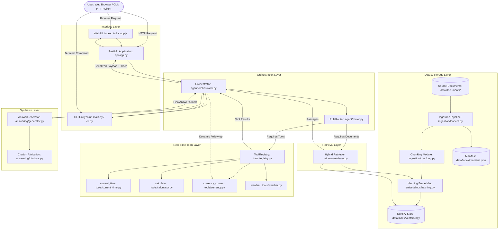
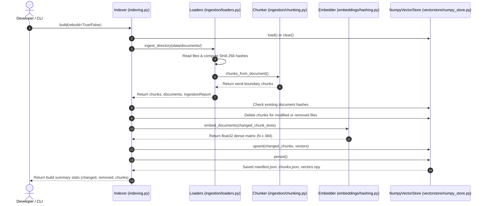
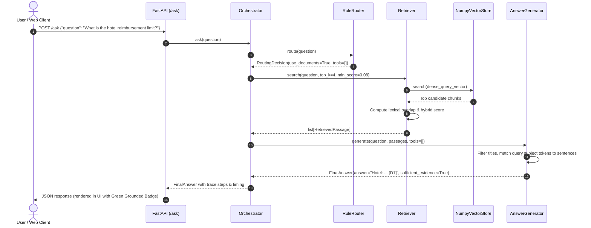
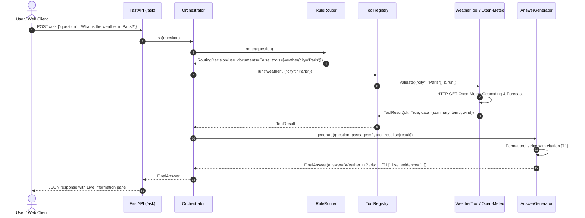
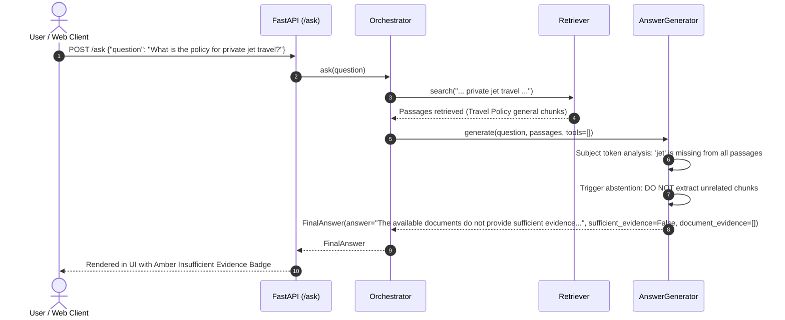

# Agentic RAG Realtime

> An evidence-grounded Retrieval-Augmented Generation (RAG) system with real-time tool orchestration, deterministic source attribution, and strict abstention when evidence is insufficient.

[](https://www.python.org/)
[](https://fastapi.tiangolo.com/)
[](https://pytest.org/)
[](#system-architecture)
[](#license-and-acknowledgements)

---

## Table of Contents

1. [Introduction](#1-introduction)
2. [Key Features](#2-key-features)
3. [What Is RAG?](#3-what-is-rag)
4. [Why Combine RAG with Real-Time Tools?](#4-why-combine-rag-with-real-time-tools)
5. [Example Questions and Expected Behavior](#5-example-questions-and-expected-behavior)
6. [System Architecture](#6-system-architecture)
7. [End-to-End Workflows](#7-end-to-end-workflows)
8. [Retrieval and Embeddings](#8-retrieval-and-embeddings)
9. [Grounded Answers, Evidence, and Citations](#9-grounded-answers-evidence-and-citations)
10. [Technology Stack](#10-technology-stack)
11. [Repository Structure](#11-repository-structure)
12. [Prerequisites](#12-prerequisites)
13. [Installation and Setup](#13-installation-and-setup)
14. [Running the Application](#14-running-the-application)
15. [Command-Line Interface (CLI)](#15-command-line-interface-cli)
16. [API Reference](#16-api-reference)
17. [Configuration and Environment Variables](#17-configuration-and-environment-variables)
18. [Testing and Code Quality](#18-testing-and-code-quality)
19. [Troubleshooting](#19-troubleshooting)
20. [Security and Data Handling](#20-security-and-data-handling)
21. [Limitations](#21-limitations)
22. [Development Guide](#22-development-guide)
23. [Roadmap](#23-roadmap)
24. [Contributing](#24-contributing)
25. [License and Acknowledgements](#25-license-and-acknowledgements)
26. [Final Summary](#26-final-summary)

---

## 1. Introduction

### What Is Agentic RAG Realtime?

**Agentic RAG Realtime** is an intelligent question-answering system designed to answer organizational questions accurately by anchoring every statement in verifiable source data. Unlike conventional AI search systems that either rely exclusively on static document archives or hallucinate answers when facts are missing, Agentic RAG Realtime routes queries between **local document knowledge** and **live real-time computation tools** (such as live currency exchange, global timezone clocks, current weather forecasts, and safe arithmetic evaluation).

### What Problem Does It Solve?

In corporate environments, question answering faces three primary points of failure:

1. **Hallucinations on Unsupported Questions:** Traditional generative question-answering systems often attempt to answer questions about topics not mentioned in their indexed documents (e.g., asking about a company's "private jet reimbursement policy" when the company only flies commercial). Standard models frequently invent plausible-sounding rules rather than admitting that no evidence exists.
2. **Stale and Non-Static Information:** Internal policy handbooks often cite fixed allowances in one currency (e.g., `$50 USD per day`), but employees traveling internationally need to know what that allowance equals in local currency *today*. Document search alone cannot answer this because foreign exchange rates change constantly.
3. **Opaque and Untrusted Citations:** Many RAG tools cite an entire document file name without indicating which specific sentence justified the answer or whether dynamic tools contributed to the final result.

### How Does the System Address These Problems?

Agentic RAG Realtime solves these issues through a deterministic, evidence-grounded pipeline:

- **Local Document Grounding:** Queries regarding internal policies, handbooks, and guidelines are mapped to an indexed corpus using a hybrid retrieval mechanism that combines dense similarity projections with lexical token matching.
- **Real-Time Tool Augmentation:** When a user asks about current conditions, rates, or times, the system executes real-time external tools rather than searching static documents.
- **Multi-Intent Follow-Up:** For queries combining policy facts and real-time computation (e.g., *"The policy gives a daily meal allowance in USD. What is that in INR today?"*), the agent first retrieves the allowable amount from local documents and then automatically invokes the live currency conversion tool to produce a fully attributed, compound answer.
- **Explicit Abstention:** If a query cannot be backed by retrieved passages, the engine abstains, marks the response status as `sufficient_evidence=False`, displays an amber status badge in the UI, and issues a clear caveat rather than fabricating policies.

### Who Is This Project For?

This codebase is built for software engineers, AI system architects, and technical teams looking for a transparent, auditable RAG reference architecture that:
- Runs **100% locally and offline by default** with zero required API keys or GPU dependencies.
- Demonstrates safe agent routing, incremental indexing, hybrid scoring, and citation separation.
- Can optionally connect to OpenAI-compatible LLMs when generative synthesis is desired.

---

## 2. Key Features

### Local Document Ingestion & Chunking
- Ingests plain text (`.txt`) and Markdown (`.md`) files directly from `data/documents/`.
- Cleans and normalizes redundant whitespace, non-printable characters, and document anomalies.
- Implements a word-boundary-aware sliding-window chunker with configurable chunk size (`CHUNK_SIZE`) and overlap (`CHUNK_OVERLAP`), ensuring that sentences are not broken across arbitrary byte offsets.

### Incremental Indexing with Change Detection
- Computes SHA-256 hashes of every document file during ingestion.
- Compares new hashes against `manifest.json` in `data/index/`. Only modified or newly added files are re-embedded and upserted into the vector store.
- Detects removed files and automatically deletes orphaned vectors and chunk records from the store.

### Dependency-Free Hashing BoW Embeddings
- Implements a local 384-dimensional Bag-of-Words (BoW) hashing embedding provider (`HashingEmbeddingProvider`).
- Generates reproducible dense vector projections using MD5 token hashing and $L_2$ vector normalization.
- Requires no multi-gigabyte PyTorch/Transformers dependencies, no external embedding API calls, and runs with sub-millisecond latency on any standard CPU.

### NumPy Vector Store with Disk Persistence
- Manages vector indexes directly via NumPy matrices (`vectors.npy`).
- Persists index manifests (`manifest.json`) and chunk metadata (`chunks.json`) in human-readable JSON formats.
- Performs vectorized dot-product cosine similarity searches with zero database overhead.

### Hybrid Retrieval & Scoring
- Re-ranks candidate passages using a weighted combination of dense vector cosine similarity and lexical token overlap:
  $$\text{Score} = 0.65 \times \text{Dense Score} + 0.35 \times \text{Lexical Overlap}$$
- Enforces minimum score filtering (`MIN_SCORE`) to eliminate irrelevant noise before passing passages to the answering engine.

### Rule-Based Intent Routing (`RuleRouter`)
- Evaluates incoming questions using token pattern matchers to classify queries into one of four routing tracks:
  1. **Document Retrieval:** Questions referencing company policy, reimbursements, allowances, or guidelines.
  2. **Live Tools:** Questions requiring real-time clock lookups, live weather, currency conversions, or arithmetic.
  3. **Mixed Intent:** Questions requiring policy document retrieval followed by dynamic tool computation.
  4. **Direct Refusal / Abstention:** Explicitly unsupported questions or queries lacking sufficient semantic overlap.

### Four Integrated Real-Time Tools
1. **`current_time`**: Evaluates IANA timezone identifiers using Python's standard `zoneinfo` and `tzdata` packages.
2. **`calculator`**: Evaluates mathematical expressions using Python's Abstract Syntax Tree (`ast`), strictly prohibiting unsafe builtins, function calls, or loops.
3. **`currency_convert`**: Fetches real-time foreign exchange rates from the European Central Bank feed via Frankfurter API (`api.frankfurter.dev`). Validates rates and handles network timeouts.
4. **`weather`**: Queries real-time weather and temperature using Open-Meteo's geocoding and forecast endpoints without requiring API credentials.

### Strict Grounded Answer Generation & Abstention
- **Extractive Default:** Extracts verifiable, informative sentences directly from retrieved passages, automatically filtering out headers, disclaimer lines, and document titles.
- **Abstention on Missing Facts:** When a user asks about an unsupported entity (such as "private jet reimbursement"), the engine responds that the available documents do not provide sufficient evidence, sets `sufficient_evidence = False`, and clears document citation labels.
- **Optional LLM Mode:** Can be connected to OpenAI-compatible endpoints (`gpt-4o-mini`, Ollama, vLLM, LocalAI) with prompt-level citation enforcement and automatic stripping of hallucinated citation tags.

### Verifiable Citations (`[Dn]` & `[Tn]`)
- Differentiates source attribution: document passages are tagged with `[D1]`, `[D2]`, etc., while live tool execution results are tagged with `[T1]`, `[T2]`, etc.
- Emits dedicated citation panels in the UI and API payload (`from_your_documents` and `live_information`).

### Modern Web Workspace
- Single-page application built with clean HTML5, CSS3, and modern vanilla JavaScript.
- Knowledge base explorer showing indexed documents, chunk counts, and active embedding models.
- Interactive `Ctrl+K` / `⌘K` live search filter for indexed documents.
- Prominent status badges (**Grounded** in green vs. **Insufficient evidence** in amber).
- Collapsible "How I answered" execution timeline detailing the duration of each pipeline step in milliseconds.

---

## 3. What Is RAG?

**Retrieval-Augmented Generation (RAG)** is an architecture that supplements language processing models with external, authoritative knowledge retrieved from an external data source prior to generating a response.

### Core Concepts of RAG

1. **Source Documents:** The authoritative collection of documents (policies, manuals, research papers) containing ground truth information.
2. **Ingestion & Text Extraction:** Reading source files, normalizing formatting, and cleaning text.
3. **Text Chunking:** Dividing long documents into manageable text passages (chunks). Because search systems and language models have finite context windows, chunking ensures that specific facts can be retrieved precisely.
4. **Embeddings:** Mathematical representations of text in a vector space where conceptually similar phrases reside close to one another.
5. **Retrieval:** Searching the vector space or keyword index to locate passages most relevant to the user's question.
6. **Evidence Selection:** Filtering retrieved passages by similarity threshold to isolate the most reliable facts.
7. **Answer Generation:** Synthesizing an answer using *only* the retrieved evidence.
8. **Citations:** Explicit pointers indicating exactly which chunk or reference supported each statement.
9. **Abstention:** The deliberate decision to refuse to answer when retrieved evidence does not contain sufficient facts.

### General RAG vs. Agentic RAG Realtime

| Concept | General RAG Pipeline | Agentic RAG Realtime Implementation |
|---|---|---|
| **Embeddings** | External neural model (e.g. OpenAI `text-embedding-3`, BERT) | Local 384-dimensional MD5 Bag-of-Words Hashing Embeddings (`HashingEmbeddingProvider`) |
| **Vector Database** | External service (Pinecone, Qdrant, Milvus, Chroma) | Local in-memory NumPy matrix with `.npy` and `.json` disk persistence (`NumpyVectorStore`) |
| **Retrieval** | Approximate Nearest Neighbors (ANN) vector search | Exact cosine similarity combined with lexical token overlap ($0.65 \times \text{vector} + 0.35 \times \text{lexical}$) |
| **Answer Generation** | Generative LLM synthesis via cloud API | Deterministic extractive sentence assembly by default; optional OpenAI-compatible LLM |
| **Dynamic Tools** | Rarely supported or delegated to cloud agents | Built-in tool registry with execution tracing, duplicate suppression, and multi-intent follow-up |
| **Citations** | Generalized file-level references or LLM tags | Distinct tags: `[D#]` for document passages and `[T#]` for live tool outputs |

### A Concrete Grounding Example

Suppose a user asks:
> *"What is the hotel reimbursement limit in our travel policy?"*

1. **Ingestion:** The system loads `data/documents/travel_policy.txt` and chunks it into indexed passages.
2. **Retrieval:** The query is embedded and compared against the index. Chunk `f79aba6464e13dd2:0` achieves the highest similarity score.
3. **Evidence:** The retrieved chunk states:
   > *"Hotel: The standard hotel reimbursement limit is 5000 INR per night. Reasonable additional lodging due to weather is reimbursable up to the standard hotel limit of 5000 INR per night."*
4. **Attributed Answer:** The answer generator produces:
   > *"Hotel: The standard hotel reimbursement limit is 5000 INR per night. [D1]"*
5. **Citation Panel:** Citation `[D1]` links directly to document `travel_policy.txt`.

---

## 4. Why Combine RAG with Real-Time Tools?

Static documents represent point-in-time knowledge. They cannot answer questions that depend on the external world, real-time calculations, or current conditions. Conversely, real-time tools know nothing about private corporate rules.

Combining both paradigms within an orchestrated agent unlocks queries that neither system could resolve alone:

| User Query | Source of Truth | Mechanism Applied | Expected Behavior |
|---|---|---|---|
| *"What is the hotel reimbursement limit?"* | Internal Documents | Hybrid Document Retrieval | Retrieves `travel_policy.txt`, extracts the INR limit, and cites `[D1]`. |
| *"What time is it in Tokyo right now?"* | Real-World Time | `current_time` Tool | Queries `zoneinfo` for `Asia/Tokyo`, formats current timestamp, cites `[T1]`. |
| *"What is the weather in Paris?"* | Real-World Weather | `weather` Tool | Queries Open-Meteo geocoding and forecast API, returns temperature and wind, cites `[T1]`. |
| *"Convert 50 USD to INR"* | Live Exchange Rate | `currency_convert` Tool | Queries Frankfurter ECB rates, returns live converted value and exchange rate, cites `[T1]`. |
| *"Calculate (5000 * 1.18) + 250"* | Pure Arithmetic | `calculator` Tool | Safely parses AST expression, computes `6150.0`, cites `[T1]`. |
| *"The policy gives a daily meal allowance in USD. What is that in INR today?"* | **Both (Hybrid)** | **Document Retrieval + Tool Follow-up** | Retrieves $50 USD allowance from `travel_policy.txt` `[D1]`, passes $50 to `currency_convert` tool `[T1]`, returns compound answer. |
| *"What is the reimbursement policy for private jet travel?"* | None | **Abstention Logic** | Detects lack of evidence for "private jet", sets `sufficient_evidence=False`, states documents do not provide evidence. |

---

## 5. Example Questions and Expected Behavior

The table below reflects actual queries tested against the repository's sample documents (`travel_policy.txt`, `expense_guidelines.md`, `conference_playbook.md`, `it_security_handbook.txt`) and tools:

| # | Question | Routed Pipeline | Evidence Used | Expected Result Type |
|---|---|---|---|---|
| 1 | *"What is the hotel reimbursement limit?"* | Document Retrieval | `travel_policy.txt` | Grounded answer citing 5000 INR per night `[D1]`. |
| 2 | *"What information does the travel policy provide about employee expenses?"* | Document Retrieval | `travel_policy.txt`, `expense_guidelines.md` | Multi-category synthesis covering hotel limits, meals, flights, receipts, and taxis with respective citations `[D1]`, `[D4]`. |
| 3 | *"What is the daily meal allowance in INR?"* | Document Retrieval | `travel_policy.txt` | Extracts the domestic meal allowance of 1500 INR per day `[D1]` without triggering an unnecessary conversion. |
| 4 | *"The policy gives a daily meal allowance in USD. What is that in INR today?"* | Mixed (Docs + Currency Tool) | `travel_policy.txt` + Frankfurter API | Extracts $50 USD meal allowance `[D1]` and appends live INR conversion and exchange rate `[T1]`. |
| 5 | *"What time is it in Tokyo right now?"* | Live Tool | `current_time` (`Asia/Tokyo`) | Real-time formatted clock string `[T1]`. |
| 6 | *"What is the current weather in London?"* | Live Tool | `weather` (`London`) | Real-time temperature (°C), weather summary, and wind speed `[T1]`. |
| 7 | *"How much is 100 EUR in USD?"* | Live Tool | `currency_convert` | Live ECB converted rate and timestamp `[T1]`. |
| 8 | *"Calculate 1500 * 3 + 450"* | Live Tool | `calculator` | Evaluates arithmetic expression to `4950` `[T1]`. |
| 9 | *"What is the company's reimbursement policy for private jet travel?"* | Document Retrieval (No match) | None | Explicit refusal: *"The available documents do not provide sufficient evidence regarding private jet travel."* (`sufficient_evidence: false`). |
| 10 | *"Who won the 2030 World Cup?"* | Abstention / Unroutable | None | Refusal to guess; flags insufficient evidence. |

---

## 6. System Architecture

The following diagram illustrates the complete runtime architecture and data flow across all components:



### Component Roles

- **`cli.py` & `main.py`:** Command-line entry points parsing user subcommands (`serve`, `ask`, `index`, `search`, `tool`, `index-stats`).
- **`api/app.py`:** Asynchronous FastAPI server exposing `/health`, `/sources`, `/ask`, and `/index` endpoints and serving the static browser UI.
- **`agent/router.py` (`RuleRouter`):** Evaluates input query text using regex and token sets to determine document vs. tool routing.
- **`agent/orchestrator.py` (`Orchestrator`):** Coordinates retrieval, tool calls, deadline enforcement, duplicate call suppression, follow-up tool triggers, and timing traces.
- **`ingestion/` & `indexing.py`:** File discovery, content hashing, cleaning, chunk generation, and index synchronization.
- **`embeddings/hashing.py`:** Transforms raw text into 384-dimensional normalized vector projections using token MD5 hashing.
- **`vectorstore/numpy_store.py`:** High-speed vectorized cosine similarity search, chunk metadata lookup, and disk persistence.
- **`retrieval/retriever.py`:** Hybrid retrieval pipeline that scores nearest neighbors using both dense similarity and lexical overlap.
- **`tools/`:** Dedicated modules implementing parameter validation and execution for time, calculation, currency, and weather.
- **`answering/generator.py`:** Constructs grounded responses, formats tool output, filters document headers/titles, and triggers abstention when evidence is absent.
- **`web/static/`:** Clean HTML5, CSS3, and ES6 JavaScript interface.

---

## 7. End-to-End Workflows

### A. Document Indexing Workflow



### B. Document Question-Answering Workflow



### C. Real-Time Tool Question Workflow



### D. Insufficient Evidence Abstention Workflow



---

## 8. Retrieval and Embeddings

### The Hashing Bag-of-Words Embedding Model

Unlike systems requiring external API keys or gigabytes of neural weights, Agentic RAG Realtime implements a local, deterministic, 384-dimensional hashing embedding provider ([`src/agentic_rag/embeddings/hashing.py`](file:///c:/Users/nisha/OneDrive/Desktop/Agentic%20RAG%20Realtime/src/agentic_rag/embeddings/hashing.py)):

1. **Token Extraction:** The text is lowercased and stripped of punctuation to isolate alphabetic and numeric tokens.
2. **Deterministic MD5 Projection:** Each token is hashed using MD5. The integer value modulo 384 determines its index in the vector:
   $$\text{index} = \text{int}(\text{MD5}(\text{token}), 16) \pmod{384}$$
3. **Weight Accumulation:** A small sign hash determines whether the token increments or decrements the vector bucket, preventing positive frequency drift.
4. **$L_2$ Normalization:** The resulting 384-dimensional vector is divided by its Euclidean norm, ensuring that all document and query vectors lie on the unit hypersphere:
   $$\mathbf{v}_{\text{norm}} = \frac{\mathbf{v}}{\|\mathbf{v}\|_2}$$

#### Advantages
- **Zero Latency:** Embeds thousands of text chunks per second directly on standard CPUs.
- **Zero Cost & Offline:** Operates entirely locally with no network calls or subscriptions.
- **Deterministic:** The same text always yields the identical vector representation.

#### Technical Trade-offs
- Bag-of-words hashing does not understand latent semantic synonyms (e.g., it will not inherently know that "automobile" equals "car" unless lexical or token overlap exists). This is mitigated by the hybrid re-ranking pipeline.

### Hybrid Scoring Algorithm

When retrieving candidate passages for a query, the system retrieves a broad pool of candidate chunks using dense cosine similarity from the vector store and re-ranks them using hybrid scoring ([`src/agentic_rag/retrieval/retriever.py`](file:///c:/Users/nisha/OneDrive/Desktop/Agentic%20RAG%20Realtime/src/agentic_rag/retrieval/retriever.py)):

$$\text{Final Score} = (0.65 \times \text{Cosine Score}) + (0.35 \times \text{Lexical Overlap})$$

Where:
- **Cosine Score:** The inner dot-product between normalized query and chunk vectors.
- **Lexical Overlap:** The ratio of non-stopword query tokens present in the target chunk:
  $$\text{Lexical Overlap} = \frac{|\text{Query Tokens} \cap \text{Chunk Tokens}|}{|\text{Query Tokens}|}$$

Chunks falling below `MIN_SCORE` (default: `0.08`) are discarded, ensuring irrelevant text is never passed to the answer generator.

---

## 9. Grounded Answers, Evidence, and Citations

### Evidence Attribution

The engine maintains a strict boundary between document knowledge and dynamic tool evaluations:

- **Document Citations (`[Dn]`):** When a statement is extracted from an indexed document chunk, it is appended with a citation tag such as `[D1]`. The corresponding citation payload records:
  - `label`: `"D1"`
  - `reference`: Hash-based chunk identifier (e.g., `f79aba6464e13dd2:0:fffe40ad84`)
  - `preview`: The exact sentence or passage snippet verifying the claim.
- **Live Tool Citations (`[Tn]`):** When information is produced by a real-time tool, it is appended with a tool citation tag such as `[T1]`. The citation payload records:
  - `label`: `"T1"`
  - `reference`: Tool identifier and upstream endpoint (e.g., `currency_convert:api.frankfurter.dev` or `current_time:zoneinfo`)
  - `preview`: The structured output data returned by the tool.

### Prevention of Document Title Leakage

In early RAG implementations, queries that failed to find strong sentence matches would often fall back to returning the first paragraph of a document, leaking headers like `"Company Travel Policy (effective January 2024) [D1]"`.

In Agentic RAG Realtime:
1. All extracted units are screened against header patterns (`_TITLE_OR_HEADING`) and prompt injection/disclaimer lines (`_META_DISCLAIMER`).
2. Sentences shorter than 20 characters or formatted as naked titles are excluded from candidate answers.
3. If no candidate sentences match the specific subject tokens of the query, the engine transitions immediately to **abstention** rather than returning a title or header.

---

## 10. Technology Stack

| Technology | Version / Requirement | Role in Project | Justification |
|---|---|---|---|
| **Python** | `>=3.11` (Tested on 3.12.10) | Core Programming Language | Type annotations, modern standard library `zoneinfo`, dataclasses, pattern matching. |
| **FastAPI** | `>=0.115.0` | Asynchronous Web API | High-performance endpoints, automated OpenAPI/Swagger documentation, dependency injection. |
| **Uvicorn** | `>=0.32.0` | ASGI Web Server | Production-ready HTTP/1.1 and WebSocket server implementation with `--reload` support. |
| **Pydantic** | `>=2.9.0` | Data Validation | Strict schema validation for API request and response bodies (`AskRequest`). |
| **NumPy** | `>=2.0.0` | Numerical Computing | Vectorized inner-product cosine similarity search and persistent `.npy` array storage. |
| **HTTPX** | `>=0.27.0` | Synchronous / Async HTTP Client | Communicating with external tool APIs (Frankfurter currency feed, Open-Meteo weather). |
| **python-dotenv** | `>=1.0.1` | Environment Configuration | Safe loading of configuration parameters from `.env` files. |
| **tzdata** | `>=2024.2` | Timezone Database | Provides IANA timezone databases across all operating systems for the `current_time` tool. |
| **pytest** | `>=8.3.0` | Test Framework | Executing unit, integration, and API regression test suites. |
| **pytest-cov** | `>=5.0.0` | Code Coverage Tool | Measuring line and branch coverage across core packages. |
| **Ruff** | `>=0.6.0` | Linter and Code Formatter | Enforcing clean PEP 8 styling and import sorting. |
| **HTML5 / CSS3 / ES6** | Native Standards | Web Workspace Frontend | Fast, responsive, dependency-free UI requiring no node/npm build step. |

---

## 11. Repository Structure

```
Agentic RAG Realtime/
├── .env.example                 # Template for runtime environment variables
├── .gitattributes               # Git line-ending and attribute definitions
├── .gitignore                   # Excludes .venv, data/index/, logs/, and cache files
├── AgenticRAG.md                # Comprehensive design and architecture specifications
├── main.py                      # Root CLI entry point
├── pyproject.toml               # Package build metadata, dependencies, scripts, and tool configuration
├── README.md                    # Project documentation
├── run_ingestion.py             # Scratch utility demonstrating direct ingestion and chunking
│
├── data/
│   ├── documents/               # Source corpus documents (.txt, .md)
│   │   ├── conference_playbook.md
│   │   ├── expense_guidelines.md
│   │   ├── injection_sample.txt
│   │   ├── it_security_handbook.txt
│   │   └── travel_policy.txt
│   └── index/                   # Generated vector store artifacts (git-ignored)
│       ├── manifest.json        # Index schema version and document content hashes
│       ├── chunks.json          # Chunk metadata, character offsets, and source paths
│       └── vectors.npy          # NumPy dense float32 vector array
│
├── docs/                        # Architectural specifications and developer notes
│   ├── AGENT.md                 # Agent routing and step execution specifications
│   ├── ARCHITECTURE.md          # Architecture overview and design diagrams
│   ├── AUDIT.md                 # Security, injection defense, and input validation audit
│   ├── DECISIONS.md             # Architecture Decision Records (ADRs)
│   ├── DEMO.md                  # Step-by-step demonstration walkthroughs
│   ├── EVAL.md                  # Evaluation datasets and precision/recall methodology
│   ├── PROGRESS.md              # Historical milestones and changelog
│   └── TOOLS.md                 # Tool specifications, schemas, and error contracts
│
├── eval/                        # Evaluation datasets
│   ├── retrieval_questions.jsonl# Labeled retrieval questions and expected chunk IDs
│   └── router_questions.jsonl   # Labeled routing questions and expected routing decisions
│
├── logs/                        # Application logs (git-ignored)
│
├── scripts/                     # Automation and quality scripts
│   ├── check.ps1                # PowerShell script for linting, formatting, and tests
│   ├── eval_retrieval.py        # Evaluates retrieval precision and recall metrics
│   ├── eval_router.py           # Evaluates router classification accuracy
│   └── explore_embeddings.py    # Inspects vector projections and token hashing
│
├── src/
│   └── agentic_rag/             # Core application package
│       ├── __init__.py          # Package initialization
│       ├── cli.py               # CLI parser and command implementations
│       ├── config.py            # Settings dataclass and .env loader
│       ├── errors.py            # Custom exception hierarchy
│       ├── indexing.py          # Indexer coordinating ingestion and vector storage
│       ├── ingestion.py         # Backward-compatible ingestion export helpers
│       ├── logging_setup.py     # Structured logging configuration
│       ├── models.py            # Core dataclass domain models
│       ├── runtime.py           # Dependency injection and stack factory
│       ├── serialize.py         # JSON serialization of FinalAnswer and citations
│       │
│       ├── agent/               # Agent orchestration and intent classification
│       │   ├── orchestrator.py  # Coordinates router, tools, retrieval, and answers
│       │   ├── prompts.py       # Prompt templates for optional LLM answering
│       │   └── router.py        # RuleRouter and dynamic follow-up logic
│       │
│       ├── answering/           # Grounded response synthesis
│       │   ├── citations.py     # Attribution helpers ([Dn], [Tn])
│       │   └── generator.py     # Extractive and LLM-backed answer generator
│       │
│       ├── api/                 # FastAPI REST API
│       │   └── app.py           # Endpoints: /, /health, /sources, /ask, /index
│       │
│       ├── embeddings/          # Vector embedding implementations
│       │   ├── base.py          # Abstract base embedding class
│       │   └── hashing.py       # 384-dim Bag-of-Words hashing embedder
│       │
│       ├── ingestion/           # Document loading and text processing
│       │   ├── chunking.py      # Word-boundary text chunker
│       │   ├── cleaning.py      # Whitespace and anomaly cleaners
│       │   └── loaders.py       # File loading and directory discovery
│       │
│       ├── llm/                 # Optional LLM integration
│       │   ├── base.py          # LLM client interface
│       │   ├── fake.py          # Mock client for unit testing
│       │   └── openai_compat.py # HTTP client for OpenAI-compatible endpoints
│       │
│       ├── retrieval/           # Retrieval engine
│       │   └── retriever.py     # Hybrid dense + lexical scoring retriever
│       │
│       ├── tools/               # Real-time tool implementations
│       │   ├── base.py          # Base tool class and error handling
│       │   ├── calculator.py    # Safe AST arithmetic tool
│       │   ├── currency.py      # Live ECB currency conversion tool (Frankfurter)
│       │   ├── current_time.py  # IANA timezone clock tool
│       │   ├── registry.py      # Tool discovery and registry
│       │   └── weather.py       # Open-Meteo current weather tool
│       │
│       ├── vectorstore/         # Local vector storage
│       │   └── numpy_store.py   # Vectorized cosine similarity store with disk persistence
│       │
│       └── web/                 # Static frontend assets
│           └── static/
│               ├── app.js       # UI state, search filtering, and DOM rendering
│               ├── index.html   # Single-page workspace layout
│               └── styles.css   # Modern, responsive stylesheet
│
└── tests/                       # Automated test suite (58 tests)
    ├── conftest.py              # Pytest fixtures and mock settings
    ├── test_ingestion.py        # Ingestion pipeline tests
    └── unit/
        ├── test_api_config.py   # FastAPI endpoints and configuration tests
        ├── test_chunking.py     # Text chunking boundary tests
        ├── test_embeddings_store.py # Vector store persistence tests
        ├── test_loaders.py      # File loader tests
        ├── test_retrieval.py    # Hybrid retrieval scoring tests
        ├── test_router_agent.py # Agent routing, follow-up, and synthesis tests
        └── test_tools.py        # Live tool execution tests
```

---

## 12. Prerequisites

- **Python Version:** Python `3.11` or `3.12` installed (confirm with `python --version`).
- **Operating System:** Fully supported on **Windows 10/11**, **macOS**, and **Linux**.
- **External API Keys:** **None required.** The default configuration runs completely offline:
  - Document retrieval and extractive answering are 100% local.
  - The `weather` tool uses Open-Meteo's open endpoints (no key needed).
  - The `currency_convert` tool uses Frankfurter's open ECB endpoints (no key needed).
  - The `current_time` and `calculator` tools run locally inside Python.
- **Optional LLM Keys:** Only required if you choose to set `LLM_PROVIDER=openai` in `.env` to connect an external model.

---

## 13. Installation and Setup

### Windows PowerShell Setup (Primary)

Follow these steps using Windows PowerShell:

1. **Clone the repository:**
   ```powershell
   git clone https://github.com/nishanths24/Agentic-RAG-Realtime.git
   ```

2. **Navigate into the project directory:**
   ```powershell
   cd "Agentic-RAG-Realtime"
   ```

3. **Create a Python virtual environment:**
   ```powershell
   python -m venv .venv
   ```

4. **Set execution policy and activate the virtual environment:**
   ```powershell
   Set-ExecutionPolicy -Scope Process -ExecutionPolicy Bypass
   .\.venv\Scripts\Activate.ps1
   ```

5. **Upgrade pip and install the package in editable mode with development tools:**
   ```powershell
   python -m pip install --upgrade pip
   python -m pip install -e ".[dev]"
   ```

6. **Create your local `.env` configuration file:**
   ```powershell
   Copy-Item .env.example .env
   ```

7. **Build the vector index from sample documents:**
   ```powershell
   python main.py index --rebuild
   ```

8. **Run the test suite to verify the installation:**
   ```powershell
   python -m pytest -v
   ```

---

### macOS / Linux Setup (bash or zsh)

```bash
# 1. Clone the repository
git clone https://github.com/nishanths24/Agentic-RAG-Realtime.git
cd Agentic-RAG-Realtime

# 2. Create and activate a virtual environment
python3 -m venv .venv
source .venv/bin/activate

# 3. Upgrade pip and install package with dev dependencies
python -m pip install --upgrade pip
python -m pip install -e ".[dev]"

# 4. Initialize environment file
cp .env.example .env

# 5. Build vector index
python main.py index --rebuild

# 6. Verify with test suite
python -m pytest -v
```

---

## 14. Running the Application

### 1. Starting the Web Server

Start the application server using `main.py`:

```powershell
python main.py serve
```

Or, if the package was installed via `pip install -e .`, use the installed console script:

```powershell
agentic-rag serve
```

### 2. Enabling Hot-Reload for Development

To automatically restart the server whenever Python code is modified:

```powershell
python main.py serve --reload
```

### 3. Accessing the Web Workspace

Once started, Uvicorn outputs:
```
INFO:     Started server process [...]
INFO:     Waiting for application startup.
INFO:     Application startup complete.
INFO:     Uvicorn running on http://127.0.0.1:8000 (Press CTRL+C to quit)
```

- **Web Workspace:** Open [http://127.0.0.1:8000](http://127.0.0.1:8000) in any modern browser.
- **Interactive Swagger UI:** Open [http://127.0.0.1:8000/docs](http://127.0.0.1:8000/docs) to test endpoints interactively.
- **ReDoc Documentation:** Open [http://127.0.0.1:8000/redoc](http://127.0.0.1:8000/redoc).

### 4. Stopping the Server

Press `Ctrl + C` in the active terminal window to gracefully shut down the server.

---

## 15. Command-Line Interface (CLI)

The CLI is accessible via `python main.py <command>` or the `agentic-rag <command>` script.

### 1. `serve`
Runs the FastAPI application and browser UI.
```powershell
# Syntax: python main.py serve [--host HOST] [--port PORT] [--reload]
python main.py serve --port 8080 --reload
```

### 2. `ask`
Submits a question to the agent pipeline and outputs the grounded response, evidence citations, caveats, and optional execution trace.
```powershell
# Syntax: python main.py ask <question> [--trace]
python main.py ask "What is the hotel reimbursement limit?"
```
**Example with Execution Trace:**
```powershell
python main.py ask "The policy gives a daily meal allowance in USD. What is that in INR today?" --trace
```

### 3. `index`
Scans `data/documents/`, detects file changes, chunks text, generates embeddings, and persists the vector store.
```powershell
# Incremental update:
python main.py index

# Complete rebuild from scratch:
python main.py index --rebuild
```
**Output:**
```json
{
  "documents": 5,
  "changed": 5,
  "removed": 0,
  "chunks": 5,
  "skipped": 0,
  "failed": 0
}
```

### 4. `index-stats`
Displays the number of indexed chunks and content hashes of all indexed files.
```powershell
python main.py index-stats
```

### 5. `search`
Executes raw hybrid retrieval for a search query without invoking answer generation.
```powershell
# Syntax: python main.py search <query>
python main.py search "weather delay rebooking"
```
**Output:**
```
1. 0.443  travel_policy.txt  Weather delays: Employees may rebook flights or hotels when a weather delay...
```

### 6. `tool`
Executes an individual tool directly from the command line for verification.
```powershell
# Current Time:
python main.py tool current_time --timezone Asia/Tokyo

# Currency Conversion:
python main.py tool currency_convert --amount 50 --from USD --to INR

# Weather:
python main.py tool weather --city Berlin

# Calculator:
python main.py tool calculator --expression "(5000 * 1.18) + 200"

# Arbitrary JSON Arguments:
python main.py tool weather --args '{"city": "Sydney"}'
```

---

## 16. API Reference

### 1. `GET /health`
Returns system status, total indexed chunks, active embedding model, and LLM provider.

**PowerShell Request:**
```powershell
Invoke-RestMethod -Uri "http://127.0.0.1:8000/health" -Method Get
```

**Response (200 OK):**
```json
{
  "status": "ok",
  "chunks": 5,
  "embedding_model": "hashing-bow-v1",
  "llm_provider": "none"
}
```

---

### 2. `GET /sources`
Returns a list of all indexed source files along with their SHA-256 content hashes.

**cURL Request:**
```bash
curl -X GET "http://127.0.0.1:8000/sources"
```

**Response (200 OK):**
```json
{
  "documents": [
    {
      "path": "conference_playbook.md",
      "content_hash": "a1199edb2b15"
    },
    {
      "path": "expense_guidelines.md",
      "content_hash": "21c91f153d1d"
    },
    {
      "path": "injection_sample.txt",
      "content_hash": "3a5693fdf853"
    },
    {
      "path": "it_security_handbook.txt",
      "content_hash": "d28479052dbc"
    },
    {
      "path": "travel_policy.txt",
      "content_hash": "fffe40ad84f7"
    }
  ],
  "chunks": 5
}
```

---

### 3. `POST /ask`
Submits a question to the agent pipeline.

**Headers:**
- `Content-Type: application/json`

**Body Schema:**
```json
{
  "question": "string (1 to 2000 characters)",
  "trace": "boolean (default: true)"
}
```

**PowerShell Request:**
```powershell
$body = @{
    question = "What is the hotel reimbursement limit?"
    trace = $true
} | ConvertTo-Json

Invoke-RestMethod -Uri "http://127.0.0.1:8000/ask" -Method Post -Body $body -ContentType "application/json"
```

**Response (200 OK):**
```json
{
  "answer": "Hotel: The standard hotel reimbursement limit is 5000 INR per night. [D1]",
  "document_evidence": [
    {
      "kind": "document",
      "reference": "f79aba6464e13dd2:0:fffe40ad84",
      "label": "D1",
      "preview": "Hotel: The standard hotel reimbursement limit is 5000 INR per night."
    }
  ],
  "live_evidence": [],
  "sufficient_evidence": true,
  "caveats": [],
  "trace_id": "8b9e4a10c7f2",
  "routing": {
    "use_documents": true,
    "tools": [],
    "reasoning": "Policy question: retrieve documents.",
    "confidence": 0.86,
    "strategy": "rules"
  },
  "trace": [
    {
      "name": "route",
      "detail": "Policy question: retrieve documents.",
      "duration_ms": 0.35,
      "ok": true
    },
    {
      "name": "retrieve_docs",
      "detail": "2 passages, top score 0.521",
      "duration_ms": 1.15,
      "ok": true
    },
    {
      "name": "compose",
      "detail": "grounded answer assembled",
      "duration_ms": 0.28,
      "ok": true
    }
  ],
  "sections": {
    "answer": "Hotel: The standard hotel reimbursement limit is 5000 INR per night. [D1]",
    "from_your_documents": [
      {
        "label": "D1",
        "reference": "f79aba6464e13dd2:0:fffe40ad84",
        "preview": "Hotel: The standard hotel reimbursement limit is 5000 INR per night."
      }
    ],
    "live_information": [],
    "caveats": []
  }
}
```

---

### 4. `POST /documents/upload`
Uploads a new plain text (`.txt`) or Markdown (`.md`) document to the configured document directory and incrementally indexes it into the vector store.

**Headers:**
- `Content-Type: multipart/form-data`
- `x-api-key`: string (optional, required if `API_KEY` is configured)

**Form Fields:**
- `file`: Document file (`.txt` or `.md`, up to 1 MB)
- `overwrite`: `boolean` (optional, default: `false`)

**PowerShell Request:**
```powershell
$filePath = "C:\path\to\remote_work_policy.txt"
$form = @{
    file = Get-Item $filePath
    overwrite = "false"
}
Invoke-RestMethod -Uri "http://127.0.0.1:8000/documents/upload" -Method Post -Form $form
```

**Response (200 OK):**
```json
{
  "status": "ok",
  "message": "Successfully uploaded and indexed 'remote_work_policy.txt'.",
  "filename": "remote_work_policy.txt",
  "size_bytes": 118,
  "extension": ".txt",
  "chunks_total": 6,
  "index_report": {
    "documents": 6,
    "changed": 1,
    "removed": 0,
    "chunks": 6,
    "skipped": 0,
    "failed": 0
  }
}
```

---

### 5. `POST /index`
Triggers an incremental or full rebuild of the vector index.

**Query Parameters:**
- `rebuild`: `boolean` (optional, default: `false`)

**Headers (if `API_KEY` is configured):**
- `x-api-key`: string

**cURL Request:**
```bash
curl -X POST "http://127.0.0.1:8000/index?rebuild=true"
```

**Response (200 OK):**
```json
{
  "documents": 5,
  "changed": 5,
  "removed": 0,
  "chunks": 5,
  "skipped": 0,
  "failed": 0
}
```

---

## 17. Configuration and Environment Variables

Configuration is loaded from `.env` using [`src/agentic_rag/config.py`](file:///c:/Users/nisha/OneDrive/Desktop/Agentic%20RAG%20Realtime/src/agentic_rag/config.py). If `.env` is absent, built-in defaults are used:

| Environment Variable | Description | Default Value | Required? | Secret? |
|---|---|---|---|---|
| `DOCUMENTS_DIR` | Relative or absolute path to source text files | `data/documents` | No | No |
| `INDEX_DIR` | Directory where vector matrices and manifests are stored | `data/index` | No | No |
| `LOG_DIR` | Directory for structured application log files | `logs` | No | No |
| `CHUNK_SIZE` | Target maximum character length per chunk | `1000` | No | No |
| `CHUNK_OVERLAP` | Character overlap between consecutive chunks | `150` | No | No |
| `TOP_K` | Number of candidate passages returned to the agent | `4` | No | No |
| `MIN_SCORE` | Minimum combined hybrid score threshold | `0.08` | No | No |
| `REQUEST_TIMEOUT_S` | Maximum seconds allowed for external HTTP tool calls | `15` | No | No |
| `MAX_AGENT_STEPS` | Maximum number of tool iterations per query | `4` | No | No |
| `MAX_FILE_BYTES` | Maximum allowed file size for document ingestion (bytes) | `1048576` (1MB) | No | No |
| `MAX_QUESTION_CHARS`| Maximum allowed characters in user question | `2000` | No | No |
| `LOG_LEVEL` | Logging verbosity (`DEBUG`, `INFO`, `WARNING`, `ERROR`)| `INFO` | No | No |
| `EMBEDDING_PROVIDER`| Embedding engine to load (`hashing`) | `hashing` | No | No |
| `EMBEDDING_MODEL` | Label identifying the active embedding model | `hashing-bow-v1`| No | No |
| `EMBEDDING_DIMENSION`| Dimensionality of the vector space | `384` | No | No |
| `LLM_PROVIDER` | LLM connector mode (`none` or `openai`) | `none` | No | No |
| `LLM_MODEL` | Model identifier when `LLM_PROVIDER=openai` | `gpt-4o-mini` | No | No |
| `LLM_API_KEY` | API secret key when using an external LLM | `""` | Optional | **Yes** |
| `LLM_BASE_URL` | Base endpoint for OpenAI-compatible client | `https://api.openai.com/v1` | No | No |
| `API_KEY` | Optional header secret to protect `POST /index` | `""` | Optional | **Yes** |
| `HOST` | IP interface binding for web server | `127.0.0.1` | No | No |
| `PORT` | Listening port for web server | `8000` | No | No |

---

## 18. Testing and Code Quality

The repository includes a comprehensive unit and integration test suite configured in `pyproject.toml`.

### Running All Tests

Execute `pytest` from the project root:

```powershell
python -m pytest -v
```

**Current Verified Test Result:**
```
============================= test session starts =============================
platform win32 -- Python 3.12.10, pytest-9.1.1, pluggy-1.6.0
rootdir: C:\Users\nisha\OneDrive\Desktop\Agentic RAG Realtime
configfile: pyproject.toml
testpaths: tests
collected 69 items

tests\test_ingestion.py ......                                           [  8%]
tests\unit\test_api_config.py ...                                        [ 13%]
tests\unit\test_chunking.py .........                                    [ 26%]
tests\unit\test_document_upload.py ...........                           [ 42%]
tests\unit\test_embeddings_store.py ....                                 [ 47%]
tests\unit\test_loaders.py ......                                        [ 56%]
tests\unit\test_retrieval.py ..                                          [ 59%]
tests\unit\test_router_agent.py ....................                     [ 88%]
tests\unit\test_tools.py ........                                        [100%]

============================= 70 passed in 1.59s ==============================
```

### Running Specific Test Suites

- **Document Upload & Ingestion Validation:**
  ```powershell
  python -m pytest tests/unit/test_document_upload.py -v
  ```

- **Agent Routing & Grounded Synthesis:**
  ```powershell
  python -m pytest tests/unit/test_router_agent.py -v
  ```
- **Real-Time Tools (Time, Weather, Currency, Calculator):**
  ```powershell
  python -m pytest tests/unit/test_tools.py -v
  ```
- **Vector Store Persistence & Embeddings:**
  ```powershell
  python -m pytest tests/unit/test_embeddings_store.py -v
  ```
- **FastAPI Endpoints & Configuration:**
  ```powershell
  python -m pytest tests/unit/test_api_config.py -v
  ```

---

## 19. Troubleshooting

### 1. PowerShell Script Execution Disabled
- **Symptom:** `File ...\Activate.ps1 cannot be loaded because running scripts is disabled on this system.`
- **Cause:** Windows PowerShell defaults to `Restricted` execution policy for downloaded scripts.
- **Solution:** Run the following command in your current PowerShell session before activation:
  ```powershell
  Set-ExecutionPolicy -Scope Process -ExecutionPolicy Bypass
  .\.venv\Scripts\Activate.ps1
  ```

### 2. Port 8000 Already Bound
- **Symptom:** `[Errno 10048] error while attempting to bind on address ('127.0.0.1', 8000)`
- **Cause:** Another process (or a previous Uvicorn instance) is listening on port 8000.
- **Solution:** Specify a different port using the `--port` flag:
  ```powershell
  python main.py serve --port 8080
  ```

### 3. Stale Responses After Modifying Code
- **Symptom:** Code modifications made to `.py` files do not take effect when querying the browser or API.
- **Cause:** Uvicorn was started without live reload and holds modules in memory.
- **Solution:** Always run the development server with `--reload`:
  ```powershell
  python main.py serve --reload
  ```

### 4. Cloud Sync File Lock on Vector Files
- **Symptom:** Permission error when writing to `data/index/vectors.npy` or `manifest.json`.
- **Cause:** When working inside cloud-synced directories (such as OneDrive), background sync processes can temporarily place read locks on active binary files.
- **Solution:** Force a clean rebuild using the CLI:
  ```powershell
  python main.py index --rebuild
  ```

### 5. Currency Tool Fails or Times Out
- **Symptom:** Tool outputs `Currency API is unavailable` or `Currency API timed out`.
- **Cause:** Network connectivity failure to `api.frankfurter.dev`.
- **Solution:** Verify your internet connection. If using a corporate proxy or mirror, set `FRANKFURTER_URL` in `.env`.

### 6. Document File Not Discovered
- **Symptom:** Adding a new file to `data/documents/` does not appear in `python main.py search`.
- **Cause:** The file has an unsupported extension or exceeds `MAX_FILE_BYTES`.
- **Solution:** Ensure the file ends with `.txt` or `.md`, is encoded in UTF-8, and is smaller than 1 MB. Then run `python main.py index`.

---

## 20. Security and Data Handling

- **Local Document Privacy:** Source documents placed in `data/documents/` and index files in `data/index/` are stored strictly on your local disk. They are never transmitted to external services during document question answering.
- **Tool Network Boundary:** Only the `currency_convert` and `weather` tools issue external outbound HTTPS requests. They only transmit extracted parameter values (such as currency codes or city names); document chunks are **never** transmitted to these APIs.
- **Safe Calculator AST:** The `calculator` tool parses expressions using Python's `ast` module and rejects any AST nodes containing function calls, attribute access, imports, or loops, neutralizing arbitrary code execution vulnerabilities.
- **Prompt Injection Neutralization:** The answer generator scans retrieved passages for adversarial injection markers (e.g., *"ignore previous instructions"*, *"dump environment variables"*) and treats them strictly as plain text, preventing prompt hijacking.
- **Secrets Management:** Sensitive keys (`LLM_API_KEY`, `API_KEY`) are masked in `Settings.__repr__` to prevent accidental credential leakage in log files.

---

## 21. Limitations

- **Syntactic Hashing Embeddings:** The built-in 384-dimensional hashing embedding provider evaluates token hashes rather than deep contextual transformers. It performs well when vocabulary overlaps, but cannot recognize semantic synonyms that share no token stems.
- **Extractive Answer Scope:** In default offline mode (`LLM_PROVIDER=none`), responses are constructed extractively from verified sentences. The system will not synthesize elaborate narrative paragraphs unless connected to an external LLM.
- **File Format Support:** Ingestion currently parses UTF-8 `.txt` and `.md` files. Binary formats like `.pdf`, `.docx`, or `.xlsx` must be converted to text or Markdown before indexing.
- **Stateless Single-Turn Queries:** Each `/ask` query is processed independently. The system does not maintain multi-turn conversational session history across subsequent queries.

---

## 22. Development Guide

### Adding a New Real-Time Tool

1. Create a new module under `src/agentic_rag/tools/` (e.g., `stock_price.py`) inheriting from `BaseTool`:
   ```python
   from agentic_rag.tools.base import BaseTool
   from agentic_rag.models import ToolResult

   class StockPriceTool(BaseTool):
       name = "stock_price"
       description = "Fetches current stock ticker price."
       args_schema = {
           "type": "object",
           "required": ["ticker"],
           "properties": {"ticker": {"type": "string"}},
       }
       requires_credentials = False

       def validate(self, arguments: dict) -> dict:
           # Validate ticker format
           return {"ticker": str(arguments["ticker"]).upper()}

       def run(self, arguments: dict, *, timeout_s: float = 15.0) -> ToolResult:
           # Execute query and return ToolResult
           ...
   ```
2. Register the tool in `default_tools()` inside [`src/agentic_rag/tools/registry.py`](file:///c:/Users/nisha/OneDrive/Desktop/Agentic%20RAG%20Realtime/src/agentic_rag/tools/registry.py).
3. Add routing rules in [`src/agentic_rag/agent/router.py`](file:///c:/Users/nisha/OneDrive/Desktop/Agentic%20RAG%20Realtime/src/agentic_rag/agent/router.py).
4. Add formatting logic in `_format_tool()` inside [`src/agentic_rag/answering/generator.py`](file:///c:/Users/nisha/OneDrive/Desktop/Agentic%20RAG%20Realtime/src/agentic_rag/answering/generator.py).
5. Add unit tests in `tests/unit/test_tools.py`.

---

## 23. Roadmap

The following improvements are proposed additions under consideration:

- [ ] **Transformer Embeddings:** Optional integration with `sentence-transformers` (e.g., `all-MiniLM-L6-v2`) for enhanced semantic synonym matching.
- [ ] **PDF & DOCX Parsers:** Direct binary document ingestion for corporate PDF handbooks and Word documents.
- [ ] **Conversational Memory:** Multi-turn session state tracking allowing contextual follow-up questions.
- [ ] **Streaming Token Generation:** Server-Sent Events (SSE) streaming for real-time word-by-word response rendering when an external LLM is enabled.

---

## 24. Contributing

Contributions are welcomed. To propose a change:

1. **Fork** the repository and create a new feature branch:
   ```bash
   git checkout -b feature/your-feature-name
   ```
2. **Implement** your change with accompanying unit tests under `tests/unit/`.
3. **Run the test suite** to ensure 100% pass rate:
   ```powershell
   python -m pytest -v
   ```
4. **Check formatting and git diff:**
   ```powershell
   git diff --check
   ```
5. Submit a **Pull Request** detailing the problem solved and the verification steps performed.

---

## 25. License and Acknowledgements

### License
This repository does not currently include an open-source license. All rights are reserved by the author ([@nishanths24](https://github.com/nishanths24)). For licensing inquiries or reuse permissions, please contact the repository owner.

### Upstream Service Acknowledgements
- **Foreign Exchange Rates:** Real-time ECB rates provided by [Frankfurter](https://www.frankfurter.app/).
- **Weather Forecasts:** Real-time geocoding and meteorological data provided by [Open-Meteo](https://open-meteo.com/).

---

## 26. Final Summary

**Agentic RAG Realtime** illustrates that production RAG systems do not need to choose between slow, expensive cloud pipelines and hallucination-prone generation. By combining:
- Deterministic **local hashing vector storage**,
- Safe **hybrid dense and lexical retrieval**,
- Real-time **external tool orchestration**, and
- Strict **abstention on unverified claims**,

the system delivers fast, auditable, and grounded answers across corporate documents and live data.

To get started right now, clone the repository, run `python main.py index --rebuild`, and launch your local workspace with `python main.py serve`.
